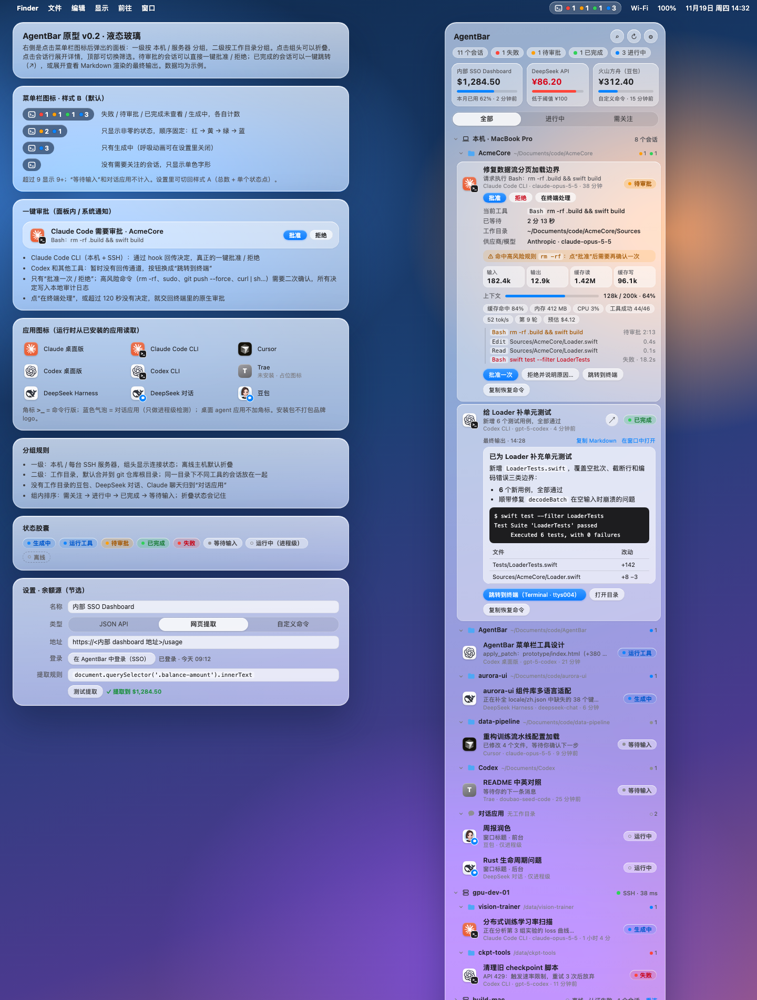

# feat: AgentBar v0.2 — macOS 液态玻璃菜单栏 Agent 监控、一键审批与 DMG 安装包

## 概要

实现基于 Swift 6 + AppKit/SwiftUI 原生液态玻璃（`NSGlassEffectView` / `glassEffect`）的 macOS 菜单栏工具 **AgentBar**，并完成 `.app` 与 `.dmg` 镜像编译打包。

## 核心特性

1. **多点计数状态栏图标（默认样式 B，可切换样式 A）**
   - 单色 `[>_]` 图标 + 非零状态彩色圆点与数量（🔴 失败 → 🟡 待审批 → 🟢 已完成 → 🔵 进行中，上限 `9+`）。
2. **原生 macOS 液态玻璃 UI & 真实应用 Logo**
   - 面板采用 `NSGlassEffectView`（圆角 22pt）+ SwiftUI `GlassEffectContainer`、`.glassEffect`、`.buttonStyle(.glass)` / `.buttonStyle(.glassProminent)`。
   - 运行时通过 `NSWorkspace` 动态读取已安装应用图标（Claude、Codex/ChatGPT、DeepSeek Harness、Cursor、豆包），通过 `>_` 角标区分 CLI、蓝色气泡角标区分对话应用。
3. **两级折叠分组（本机/SSH 主机 → Git 工作目录）**
   - 一级按本机与 SSH 服务器分组（展示在线延迟 ms / 离线原因与重连）；二级自动合并到 Git 仓库根目录，无工作目录的对话应用归入“对话应用”。
4. **多工具真实会话与评价指标解析**
   - 本机直读 Claude Code (`~/.claude/projects`)、Codex 桌面版/CLI (`~/.codex/sessions` + `session_index.jsonl`)、DeepSeek Harness (`~/.dsh/storages/session_projcache`)、Cursor/Trae (`state.vscdb` 只读 SQLite) 及豆包/DeepSeek 进程信息。
   - 展示输入/输出/缓存读/缓存写/推理 Token、上下文窗口占用条、缓存命中率、物理内存（`ri_phys_footprint`）与 CPU%、输出速度（tok/s）、工具成功率、最近工具时间线与预估成本。
5. **一键审批 + 一键跳转 + 面板内 Markdown 输出预览**
   - 内置 `agentbar-hook` 可执行程序与设置向导（自动备份 `~/.claude/settings.json`），支持在面板和系统通知上直接批准/拒绝 Claude Code 权限请求，高风险命令（`rm -rf`、`git push --force` 等）二次确认并记录审计日志。
   - 已完成会话行内一键跳转终端对应 TTY 标签页或应用（`↗`），展开即可查看 Markdown 渲染结果（标题、列表、带复制按钮的代码块、GFM 表格）或独立窗口查看。
6. **可选余额 Dashboard**
   - 支持网页提取（内置持久化 `WKWebView` SSO 登录窗口，适配内部 SSO Dashboard 等场景）、JSON API（Token 存 Keychain，内置 DeepSeek 模板）和自定义 Shell 命令。

## 原型与视觉参考

## 验证与产物

- `swift test`：覆盖 Claude Code `message.id` 用量去重、Codex rollout / 子代理过滤、高风险审批命令识别。
- `./scripts/build_dmg.sh`：Release 编译 `AgentBar` 与 `agentbar-hook`，生成 `AppIcon.icns`，完成 ad-hoc 签名并输出 `dist/AgentBar.app` 与 `dist/AgentBar.dmg`。
