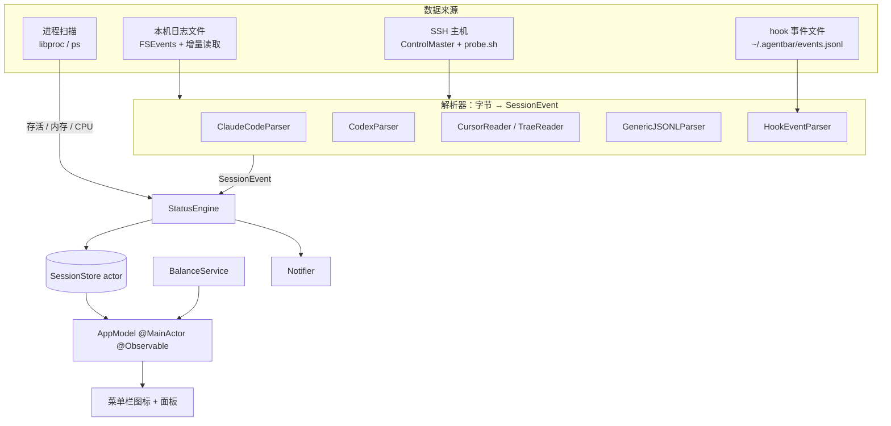
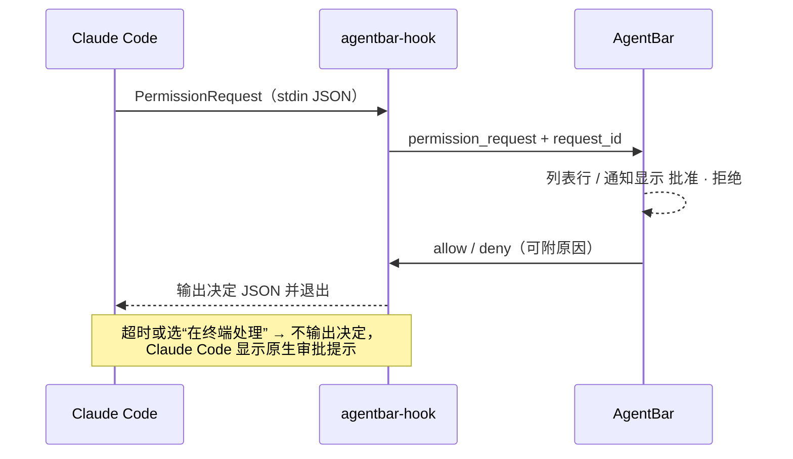

# AgentBar 技术设计

> 版本 v0.2 · 2026-11-19 · 配合 [REQUIREMENTS.md](REQUIREMENTS.md) 阅读

## 1. 技术选型

| 项 | 选择 | 理由 |
|---|---|---|
| UI | SwiftUI `MenuBarExtra`（`.window` 样式）+ 液态玻璃（`glassEffect`、`GlassEffectContainer`、`.buttonStyle(.glass)`） | 原生菜单栏面板，视觉与系统一致 |
| 最低系统 | macOS 26 | 液态玻璃 API 从 macOS 26 开始提供 |
| 状态管理 | Observation（`@Observable`）+ Swift 6 严格并发 | 原生支持 |
| 构建 | Swift Package Manager | 本机目前只有 Command Line Tools（Swift 6.4，没有 Xcode），SPM 可以直接编译 |
| 打包 | `scripts/bundle.sh` 组装 `.app` + ad-hoc 签名 | 通知、开机自启需要 `.app` bundle；以后装了 Xcode 可以换成 Xcode 工程并做公证 |
| 文件监听 | FSEvents | 开销低，按目录监听 |
| SQLite | 系统 `SQLite3`，只读打开 | 读取 Cursor / Trae 的 `state.vscdb` |
| 密钥 | Keychain Services | 余额 API token |
| 网页提取 | `WKWebView` + 持久化 `WKWebsiteDataStore` | 保留 SSO 登录态 |
| 应用形态 | `LSUIElement = YES` | 不显示 Dock 图标 |
| 应用图标 | `NSWorkspace.urlForApplication(withBundleIdentifier:)` + `icon(forFile:)` | 运行时读取已安装应用的 logo，不打包品牌素材 |
| 窗口标题（可选） | Accessibility（`AXUIElement`） | 对话应用的会话标题，需要用户授权 |

## 2. 架构



核心原则：**传输与解析分离**。解析器只处理字节，不关心字节来自本机文件还是 SSH，所以远端不需要部署任何解析逻辑，本机和远端共用一套解析器和测试。

## 3. 目录结构（M1 起）

```
AgentBar/
├── Package.swift
├── Sources/
│   ├── AgentBarApp/         # @main、MenuBarExtra、各视图
│   ├── AgentBarCore/        # 数据模型、SessionStore、StatusEngine、指标
│   ├── AgentBarAdapters/    # 各工具的解析器与文件定位
│   ├── AgentBarTransport/   # LocalFS / SSH / ProcessScanner
│   ├── AgentBarBalance/     # 余额源
│   └── agentbar-hook/       # 供 Claude Code / Codex hooks 调用的小 CLI
├── Resources/
│   ├── probe.sh             # 远端探针（POSIX sh）
│   └── agentbar-hook.sh     # 远端版 hook（POSIX sh）
├── Tests/
│   ├── Fixtures/            # 脱敏后的真实日志样本
│   └── ...
└── scripts/bundle.sh        # 在 CLT 环境下组装 .app 并 ad-hoc 签名
```

## 4. 数据模型

```swift
enum AgentKind: String, Codable, CaseIterable, Sendable {
    case claudeCode, claudeDesktop, codexCLI, codexDesktop, deepseekHarness, deepseekChat, doubao, cursor, trae, generic
}

enum HostID: Hashable, Codable, Sendable {
    case local
    case ssh(alias: String)
}

struct SessionGroupKey: Hashable, Codable, Sendable {
    let host: HostID
    let directory: String?
}

enum SessionStatus: Int, Codable, Sendable, Comparable {
    case failed, awaitingApproval, completed, generating, runningTool, waitingForInput, running, idle, offline

    static func < (lhs: Self, rhs: Self) -> Bool { lhs.rawValue < rhs.rawValue }
}

struct TokenUsage: Codable, Sendable {
    var input = 0
    var output = 0
    var cacheRead = 0
    var cacheWrite = 0
    var reasoning = 0
}

struct ToolCall: Identifiable, Codable, Sendable {
    let id: String
    var name: String
    var summary: String
    var startedAt: Date
    var finishedAt: Date?
    var failed = false
}

struct ProcessStats: Codable, Sendable {
    var pid: Int32
    var memoryBytes: UInt64
    var cpuPercent: Double
}

struct OutputRef: Codable, Sendable {
    let path: String
    let offset: UInt64
    let length: Int
}

struct AgentSession: Identifiable, Codable, Sendable {
    let id: String
    let kind: AgentKind
    let host: HostID
    var title: String
    var overview: String
    var status: SessionStatus
    var statusIsInferred = false
    var cwd: String?
    var provider: String?
    var model: String?
    var usage = TokenUsage()
    var lastPromptTokens: Int?
    var contextWindow: Int?
    var currentTool: ToolCall?
    var recentTools: [ToolCall] = []
    var pendingApprovalID: String?
    var lastOutput: OutputRef?
    var process: ProcessStats?
    var startedAt: Date
    var lastActivityAt: Date
    var seen = false
}

enum SessionEvent: Sendable {
    case metadata(title: String?, cwd: String?, provider: String?, model: String?)
    case turnStarted(Date)
    case assistantText(String, Date)
    case toolStarted(ToolCall)
    case toolFinished(id: String, failed: Bool, at: Date)
    case permissionRequested(requestID: String?, summary: String, at: Date)
    case usage(TokenUsage, contextWindow: Int?, cumulative: Bool)
    case compacted(Date)
    case turnCompleted(Date, output: OutputRef?)
    case error(String, Date)
}

protocol SessionParser: Sendable {
    var kind: AgentKind { get }
    func sessionID(forPath path: String) -> String?
    mutating func consume(line: Substring) -> [SessionEvent]
}
```

`SessionStatus` 的 rawValue 顺序就是状态的紧急程度，用于排序和样式 A 的状态点。`SessionGroupKey.directory` 是规范化后的分组目录（§10.3），对话应用为 `nil`。

## 5. 适配器

### 5.1 增量读取

- 每个文件记录 `(device, inode, offset)`；收到 FSEvents 通知后从 offset 读取新增字节，按 `\n` 切分，末尾不完整的行留到下一次
- inode 变了或文件变短 → 从头重读
- 首次启动只扫描最近 24h（可配置）修改过的文件
- 游标持久化到 `~/Library/Application Support/AgentBar/cursors.json`（只存 offset，不存内容），重启后不需要全量重读

### 5.2 Claude Code

- 位置：`~/.claude/projects/<编码后的 cwd>/<session-id>.jsonl`
- 标题：`ai-title` 记录（本机已确认存在）；没有时取首条用户消息前 40 个字
- 模型 / Token：`assistant` 记录的 `message.model` 和 `message.usage`；同一条消息可能分多行写入，按 `message.id` 去重后再累加
- 工具调用：assistant `content[].type == "tool_use"` 开始，对应的 user `tool_result` 结束（`is_error` 判定失败）
- 工作目录：记录上的 `cwd` 字段
- 供应商：默认 Anthropic；根据 `~/.claude/settings.json` 的 `env` 里是否存在 `CLAUDE_CODE_USE_BEDROCK` / `CLAUDE_CODE_USE_VERTEX` 推断（只判断键是否存在，不读取值）
- 桌面版 Code 模式：预计写入同一目录，用记录中的入口字段区分（实现前用样本确认）

### 5.3 Codex（CLI + 桌面版）

- 位置：`~/.codex/sessions/YYYY/MM/DD/rollout-<时间>-<uuid>.jsonl`
- `session_meta`：会话 ID、cwd、来源（用 originator / source 字段区分 CLI 和桌面版，实现前用样本确认）
- `turn_context`：model、cwd、审批策略、sandbox
- `event_msg:task_started` / `task_complete`：本轮边界 → 生成中 / 已完成
- `event_msg:token_count`：累计 token（含 cached input、reasoning）和模型上下文窗口，直接取最新一条
- `response_item` 中的 function call / output：工具调用
- 标题：rollout 里如果有线程名就用线程名，否则取首条用户消息
- 供应商：`~/.codex/config.toml` 的 `model_provider` 与 `[model_providers.*]`，只取名称和 base_url 的 host

### 5.4 Cursor / Trae（P2，尽力而为）

- Cursor：`~/Library/Application Support/Cursor/User/globalStorage/state.vscdb` 中 `cursorDiskKV` 表的 `composerData:*` 键（格式不公开，版本之间会变）
- 用 `file:<path>?mode=ro` 只读打开；解析失败就降级为进程级（“Cursor 运行中”）
- Trae 预计结构类似（`~/Library/Application Support/Trae/`），实现前先拿样本确认

### 5.5 DeepSeek harness / 其他工具

- `GenericJSONLParser`：用户在设置里配置日志 glob 和字段映射（title / status / model / usage 的 JSONPath）
- 也可以在 harness 里调用 `agentbar-hook emit ...` 主动上报（§6）
- 等确认 harness 的日志位置后，再决定是否写专用解析器

### 5.6 进程扫描

- 本机：`proc_listpids` + `proc_pidpath` 匹配 `claude`、`codex`、`Cursor`、`Trae` 等进程；`proc_pidinfo(PROC_PIDVNODEPATHINFO)` 取 cwd 与会话匹配；`proc_pid_rusage` 取 `phys_footprint`
- 远端：`ps -eo pid,ppid,rss,pcpu,etimes,args`，Linux 上再用 `readlink /proc/<pid>/cwd`
- 用途：判断进程是否存活（区分“等待输入”和“空闲”），提供内存 / CPU 指标

### 5.7 对话应用（豆包、DeepSeek 对话、Claude 聊天模式）

- 只做进程级检测：`NSRunningApplication` 按 bundle ID 匹配（豆包为 `com.bot.neotix.doubao`）
- 可选：用户授予辅助功能权限后，通过 `AXUIElement` 读取窗口标题作为会话标题
- 状态只有“运行中 / 未运行”；不读取这些应用的本地数据库，也不计入菜单栏计数

### 5.8 供应商识别

按 API base URL 的 host 映射供应商，覆盖 Claude Code / Codex / harness 接第三方模型的情况（只读 base URL，不读 key）：

| host | 供应商 |
|---|---|
| `api.anthropic.com` | Anthropic |
| `api.openai.com` | OpenAI |
| `api.deepseek.com` | DeepSeek |
| `ark.cn-beijing.volces.com` | 火山方舟（豆包） |
| `bedrock-runtime.*.amazonaws.com` | AWS Bedrock |
| `*-aiplatform.googleapis.com` | Google Vertex AI |
| 其他 | 直接显示 host |

### 5.9 最终输出读取

- 解析时只记录每个会话“本轮最后一条 assistant 消息”所在的文件、偏移和长度（`OutputRef`），不保存内容
- 展开会话时按偏移读取：Claude 取该消息的 text 块拼接；Codex 取最后一条 assistant `message`
- 远端经 SSH 用 `tail -c +<offset> <file> | head -c <length>` 读取
- 单条输出上限 256 KB，超出截断，并提示“在窗口中打开”

## 6. 实时事件：hooks

只靠日志文件很难可靠地判断“待审批”。方案是提供一个小 CLI `agentbar-hook`，由各工具的 hook 调用，它只做一件事：往 `~/.agentbar/events.jsonl` 追加一行事件。

```json
{"ts":"2026-11-19T14:30:02+08:00","tool":"claude-code","session":"3f9c1a2e-…","event":"permission_request","detail":"Bash: swift build","cwd":"/Users/dev/AcmeCore"}
```

- 本机和远端用同一套机制：本机用 FSEvents 监听这个文件，远端由 `probe.sh` 顺带读取增量
- Claude Code：在 `~/.claude/settings.json` 注册 `SessionStart`、`UserPromptSubmit`、`PreToolUse`、`PostToolUse`、`PermissionRequest`、`Notification`（权限提示）、`Stop`
- Codex：`config.toml` 的 `notify`（本轮完成）；如果用户已经配置了 notify 程序，`agentbar-hook` 负责转发给原程序。Codex 的审批事件是否写进 rollout 需要验证；拿不到时用启发式：存在未结束的工具调用、超过 3s 没有新事件且进程存活 → 显示“运行工具”并标注“可能待审批”
- 远端的 `agentbar-hook` 是一个 POSIX sh 脚本，安装向导可以用 scp 一键放到 `~/.agentbar/bin/`；本机用 Swift 编译版
- 安装 hooks 一律走向导：先展示 diff，用户确认后才写入，原文件备份为 `*.agentbar-bak`

### 6.1 一键审批（决定回传）

Claude Code 的 `PermissionRequest` hook 可以直接返回允许 / 拒绝；版本较旧时退回用 `PreToolUse` 的 `permissionDecision`。实现前按当时的 Claude Code 版本确认字段。



- 本机通道：Unix socket `~/.agentbar/agentbar.sock`（权限 0600），hook 连上后阻塞等待决定
- 远端通道：hook 轮询 `~/.agentbar/decisions/<request_id>`；AgentBar 通过已有的 ControlMaster 连接写入这个文件
- `request_id` 是随机 UUID；AgentBar 只接受处于待决状态的 id，每个 id 只能用一次
- 超时默认 120s，可配置。hook 等待期间终端里不会出现原生提示，这是“由 AgentBar 审批”模式的代价，所以提供按主机关闭的开关
- 高风险规则：对 Bash 命令和文件路径做模式匹配，命中时“批准”需要二次确认
- 审计日志：`~/Library/Application Support/AgentBar/approvals.log`（JSON Lines，只在本机）
- 系统通知用 `UNNotificationCategory` 注册“批准 / 拒绝”两个操作，走同一条回传通道
- Codex：CLI 的审批在 TUI 内完成，目前没有可回传的 hook；`codex app-server` 协议里有审批请求，但只发给持有该会话的客户端。v1 对 Codex 只做跳转，之后再研究

## 7. 状态推断（StatusEngine）

每个会话维护一个状态机，事件可信度：hook 事件 > 日志事件 > 进程信息 > 超时。

| 条件（从上往下匹配） | 状态 |
|---|---|
| 错误事件（API 错误 / 工具连续失败 ≥ 3 次 / 进程非零退出） | 失败 |
| 收到 `permission_request`，之后还没有 `PostToolUse` 或新输出 | 待审批 |
| 有未结束的工具调用 | 运行工具 |
| 本轮已开始、未结束 | 生成中 |
| 本轮结束，用户未查看 | 已完成 |
| 本轮结束，已查看，进程存活 | 等待输入 |
| 进程已退出，或超过 30min 无活动 | 空闲 |
| 远程主机不可达 | 离线（保留最后已知状态，置灰） |

“已查看”= 用户打开面板时该会话可见，或者点开了它的详情。状态机实现为纯函数 `(SessionState, SessionEvent) -> SessionState`，用表驱动测试覆盖。

## 8. SSH 远程

- 每台主机复用一条连接：

  ```bash
  ssh -o BatchMode=yes -o ControlMaster=auto -o ControlPath=~/.agentbar/cm-%C \
      -o ControlPersist=10m <host> sh -s < probe.sh
  ```

- `probe.sh` 从 stdin 接收上一次的游标（每个文件的 inode + offset），输出带分隔头的增量块：

  ```
  @@FILE claude /home/u/.claude/projects/x/abc.jsonl <inode> <offset>
  <新增字节>
  @@PS
  <ps 输出>
  @@END
  ```

- 本机收到后交给同一套解析器；远端只依赖 POSIX `sh`、`find`、`stat`、`tail`、`ps`
- 单次增量设上限（默认每个文件 2 MB），超过时只取尾部，并把该会话的 token 统计标记为“部分”
- 失败处理：10s 超时；连续失败时指数退避（5s → 5min），面板显示失败原因（认证失败 / 不可达 / 超时）

## 9. 余额（BalanceService）

```swift
enum BalanceSourceKind: Codable, Sendable {
    case jsonAPI(url: URL, headerKeychainRefs: [String: String], jsonPath: String)
    case webExtract(url: URL, extractor: String)
    case command(String)
}
```

- JSON API：`URLSession`，请求头的值存在钥匙串；内置 DeepSeek 模板（`GET https://api.deepseek.com/user/balance`）
- 火山方舟（豆包）的余额接口需要 AK/SK 签名，v1 用“自定义命令”接入用户自己的脚本，之后再考虑内置模板
- 网页提取：用户点“登录”时弹出 AgentBar 自己的 `WKWebView` 窗口完成 SSO，cookie 存在专用的持久化 data store；刷新时在后台加载页面，执行用户配置的 CSS 选择器或 JS 表达式取数值。适合企业内部这类需要 SSO 的 dashboard
- 自定义命令：`/bin/zsh -lc <cmd>`，10s 超时，取 stdout 中的第一个数字
- 默认每 15min 刷新；失败时显示上次的值并标注“已过期”

## 10. 菜单栏图标

- 默认样式 B（多点计数）：单色字形 + 非零状态的彩色点和数量，顺序固定 红 → 黄 → 绿 → 蓝，超过 9 显示 `9+`
- 样式 A（总数 + 单个最高优先级点）保留为设置项
- 实现注意：`MenuBarExtra` 的 label 一般按模板图（单色）渲染，彩色点可能被去色。M1 先验证：用 `ImageRenderer` 生成 `isTemplate = false` 的 `NSImage` 作为 label；不行就改用 `NSStatusItem` + 自定义图片，面板用 `NSPanel` 承载 SwiftUI 视图
- 字形跟随菜单栏浅色 / 深色；彩色点加 0.5pt 描边，在两种菜单栏上都看得清

### 10.1 液态玻璃

| 元素 | 实现 |
|---|---|
| 面板背景 | `MenuBarExtra(.window)` 使用系统玻璃背景；若退到 `NSPanel`，用 `NSGlassEffectView` 作为内容视图 |
| 余额卡片、展开的会话 | `.glassEffect(.regular, in: .rect(cornerRadius: 14))`，相邻元素放进同一个 `GlassEffectContainer` |
| 状态胶囊 | `.glassEffect(.regular.tint(statusColor.opacity(0.3)), in: .capsule)` |
| 按钮 | `.buttonStyle(.glass)`，主要操作用 `.buttonStyle(.glassProminent)` |
| 筛选 | 系统 `Picker` + `.pickerStyle(.segmented)` |

- 圆角同心：面板 22pt → 卡片 14pt → 行 12pt → 胶囊
- 玻璃只用在浮于内容之上的控件层，列表正文不叠多层玻璃，保证文字可读
- “降低透明度”打开时由系统换成不透明材质，不额外处理

### 10.2 应用图标

| 形态 | bundle ID（本机已确认） | 图标来源 | 角标 |
|---|---|---|---|
| Claude 桌面版 | `com.anthropic.claudefordesktop` | Claude.app | — |
| Claude Code CLI | — | Claude.app | `>_` |
| Codex 桌面版 | `com.openai.codex`（ChatGPT.app） | ChatGPT.app | — |
| Codex CLI | `com.openai.codex.cli`（自身没有图标） | ChatGPT.app | `>_` |
| Cursor | `com.todesktop.230313mzl4w4u92` | Cursor.app | — |
| Trae | 本机未安装，待确认 | 占位图标 | — |
| DeepSeek Harness | `com.deepseek.dsh` | DeepSeek Harness.app | — |
| DeepSeek 对话 | 本机未安装 | 同家族：DeepSeek Harness.app | 气泡 |
| 豆包 | `com.bot.neotix.doubao` | Doubao.app | 气泡 |

- 解析顺序：按 bundle ID 找已安装应用 → 同家族的其他应用 → 内置单色占位图标
- 图标按尺寸缓存在内存里；远端会话也用本机的图标
- 安装包不打包品牌 logo；`prototype/assets/` 里的图标是从本机应用导出的，只用于评审

### 10.3 分组

- 一级：`HostID`；二级：`SessionGroupKey.directory`
- 目录规范化：解析符号链接 → 向上查找 `.git`，合并到仓库根目录（可关闭）→ 家目录缩写为 `~`。远端由 `probe.sh` 对每个不同的 cwd 执行一次 `git rev-parse --show-toplevel`，并上报 `$HOME`
- 没有 cwd 的会话 `directory = nil`，显示为“对话应用”
- 折叠状态按组 ID 存进 `UserDefaults`；离线主机默认折叠
- 组排序：组内最紧急的状态 → 最近活动时间

### 10.4 Markdown 渲染

- 用 Apple 的 [swift-markdown](https://github.com/swiftlang/swift-markdown)（基于 cmark-gfm，支持 GFM 表格）解析，自己写 SwiftUI 渲染：段落和行内样式用 `AttributedString`，代码块用等宽字体 + 复制按钮，表格用 `Grid`
- 不加载远程图片；链接用默认浏览器打开
- 面板里的输出卡片最高 260pt，超出滚动；“在窗口中打开”用独立的 `Window` 场景显示同一个视图

### 10.5 跳转

| 场景 | 做法 |
|---|---|
| 本机 CLI · Terminal / iTerm2 | 用 `proc_pidinfo(PROC_PIDTBSDINFO)` 拿到进程的 tty，AppleScript 找到对应标签页并激活（需要“自动化”权限） |
| 本机 CLI · 其他终端 | 沿父进程找到终端应用并激活 |
| 桌面应用 | `NSRunningApplication.activate()`；没在运行就按 bundle ID 打开 |
| 远端 · tmux | 打开终端执行 `ssh -t <host> tmux attach -t <session>`，并选中对应 pane |
| 远端 · 非 tmux | 打开终端执行 `ssh -t <host> 'cd <cwd>; exec $SHELL'`，同时把恢复命令复制到剪贴板 |

## 11. 安全与隐私

- 所有会话文件只读；只有 hooks 向导会写配置文件，而且必须经用户确认
- 会话内容只在内存里做摘要，展开查看输出时按需读取；都不落盘（游标文件只存 offset），不出网
- 一键审批只通过 hook 的正式返回值生效，不模拟键盘输入；每个决定都要用户显式点击
- 网络访问只有两类：用户配置的 SSH 主机、用户配置的余额源
- 不读取任何 API key；读配置文件时只取明确列出的非敏感字段

## 12. 性能

- FSEvents 事件 200ms 合并
- 只对活跃会话做完整解析，历史会话只读元数据
- 面板关闭时降低远端轮询频率；UI 只在状态变化时刷新

## 13. 测试

- 解析器：把脱敏后的真实样本放进 `Tests/Fixtures/`，用 swift-testing 做快照测试
- 状态机：表驱动测试
- `probe.sh`：shellcheck + 在 Linux 容器里跑集成测试
- 手动验收：每种状态各造一个会话，逐一核对图标和面板

## 14. 里程碑

| 阶段 | 内容 |
|---|---|
| M0（本 PR） | 需求、设计、可交互原型 |
| M1 | SPM 工程骨架；Claude Code + Codex 本机适配器；液态玻璃面板 + 两级分组 + 详情；多点菜单栏图标（含彩色 label 验证）；应用图标解析；状态机；Markdown 输出查看 |
| M2 | hooks 向导与 `agentbar-hook`；一键审批（本机）；系统通知（含操作按钮）；一键跳转；进程指标 |
| M3 | SSH 远程（`probe.sh`、复用连接、离线处理）；远端审批回传与输出读取 |
| M4 | 余额源（三种类型）；指标汇总与价目表 |
| M5 | DeepSeek Harness / Cursor / Trae 适配器；豆包 / DeepSeek 对话进程检测；打包与开机自启 |

## 15. 风险

| 风险 | 应对 |
|---|---|
| 各工具日志格式不公开、随版本变化 | 每个适配器独立并带版本探测；解析失败降级为进程级，不影响其他工具 |
| 只靠日志难以判断“待审批” | 优先用 hooks；没有 hooks 时明确标注“推测” |
| 内部 dashboard 需要 SSO / VPN | 网页提取 + 持久化登录态；还不行就用自定义命令 |
| 没有 Xcode：用不了 Previews，也无法公证 | v1 自用不需要公证；SPM + 脚本打包足够 |
| `MenuBarExtra` label 显示不了彩色点 | 退到 `NSStatusItem` + `NSPanel`（§10） |
| 液态玻璃要求 macOS 26 | 最低版本定为 macOS 26；开发机是 macOS 27 |
| 审批等待期间终端里看不到原生提示 | 超时交回终端、“在终端处理”按钮、按主机关闭 |
| 误批危险命令 | 只有“批准一次”、高风险二次确认、审计日志 |
| Codex 拿不到审批回传通道 | v1 只做跳转；研究 `codex app-server` |
| 远端日志很大 | 增量读取 + 单次上限 |
